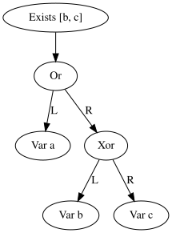
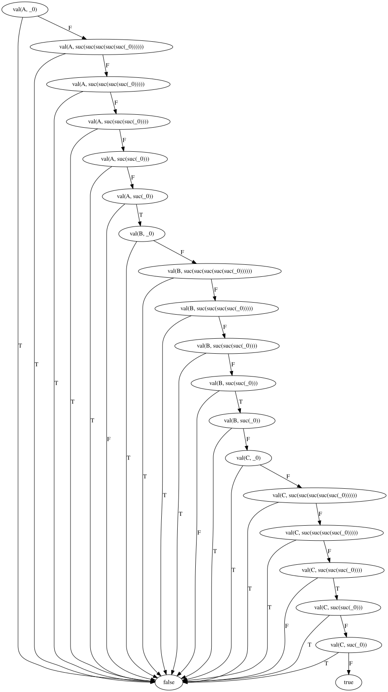
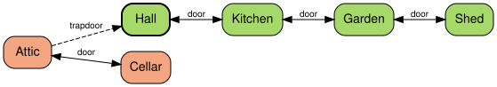
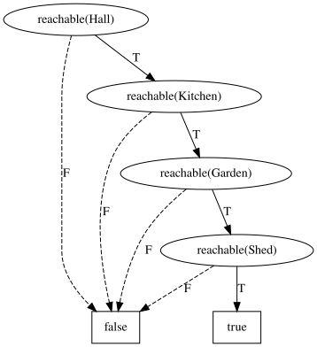

# RsBDD

[](https://github.com/timbeurskens/rsbdd/actions/workflows/rust.yml)

_Solving satisfiability problems in Rust_

## Installation

1) Make sure to install the [Rust toolchain](https://www.rust-lang.org/tools/install).

2) Clone the latest version of this repository:

```
$ git clone git@github.com:timbeurskens/rsbdd.git
```

3) Build and install the RsBDD tools:

```
$ cd rsbdd
$ cargo install --bins --path .
```

The following tools will be available after installing the RsBDD package:

- `max_clique_gen`
- `n_queens_gen`
- `random_graph_gen`
- `rsbdd`
- `sudoku_gen`

## Syntax

### Comments

Characters contained within "..." (excluding the " char itself) are regarded as comments and can be placed at any point
in the formula.

### Constants

The most basic building blocks of the syntax are 'variables' and 'constants'. A constant can be either 'true' or '
false'. A variable can accept either a 'true' or 'false' value after evaluation depending on its environment.

```
true
false
```

### Variables

A variable is a single word starting with a non-digit character. Examples of good variable names are:

```
a
a'
alpha
_x
a1
hello_world
```

### Negation

A variable, constant, or sub-formula can be negated using the negation operator. This operator can be expressed by
either `!`, `-`, or `not`.

```
not true
-false
!variable
```

### Binary operators

RsBDD supports the most common, and some uncommon binary operators, such as conjunction, disjunction, implication and
bi-implication.

Most operators have a symbolic and textual representation, e.g. `and` or `&`.

| Operator           | Option 1          | Option 2 |
|--------------------|-------------------|----------|
| Conjunction        | `and`             | `&`      |
| Disjunction        | `or`              | `\|`     |
| Implication        | `implies` or `in` | `=>`     |
| Bi-implication     | `iff` or `eq`     | `<=>`    |
| Exlusive or        | `xor`             | `^`      |
| Joint denial       | `nor`             | N.A.     |
| Alternative denial | `nand`            | N.A.     |

```
true or false
true | false
a | b
a & b
a and b
a => b
hello <=> world
on ^ off
```

### Operator precedence

Binary operators follow the usual precedence, from strongest to weakest binding:

| Precedence | Operators                 | Associativity |
|------------|---------------------------|---------------|
| 1          | `!` (negation)            | -             |
| 2          | `&`, `nand`               | left          |
| 3          | `^`                       | left          |
| 4          | `\|`, `nor`               | left          |
| 5          | `=>`, `<=`                | `=>`: right   |
| 6          | `<=>`                     | left          |

The body of a quantifier, fixed point or if-then-else extends as far to the right as possible.

```
a & b | c           <=> (a & b) | c
a & b => c          <=> (a & b) => c
a => b => c         <=> a => (b => c)
a & exists b # b | c <=> a & (exists b # (b | c))
```

### Composition

Larger formulae can be composed using left and right parentheses: `(`, `)`:

```
a | (a & b)
(a)
((a))
!(a & b)
(a & b) | (b & c)
```

### If-then-else

A simplification of a common expression `(a => b) & ((!a) => c)` can be made using the ternary if-then-else (ite)
operator.

```
if a then b else c
if exists a # a <=> b then b <=> c else false | c
```

### Quantifiers

The RsBDD supports universal and existential quantification using the `exists` and `forall`/`all`
keywords: `{forall|exists} var_1, var_2, .., var_n # {subformula}`

```
forall a # true
forall a # a | b
forall a, b # exists c # (c | a) & (c | b)
```

### Counting

For some problems it can be beneficial to express properties relating to the number of true or false variables, e.g. "at
least 2 of the 4 properties must hold".

The counting operator (`[]`) in combination with five new equality and inequality operators (`=`, `<=`, `>=`, `<`, `>`)
can be used to concisely express these properties.

_Note:_ like most operators, the counting operator can be expressed using logic primitives, but this operator simplifies
the expression significantly.

A counting comparison can either be made by comparing a set of expressions to a given constant, or an other set of
expressions.

```
"exactly one of a, b, and c holds"
[a, b, c] = 1

"there are strictly less true expressions in a, b, c than d, e, f"
[a, b, c] < [d, e, f]
```

Counting comparison also allows us to specify optimization problems.
Example: the max-clique problem can be described as a clique problem, such that
for all satisfiable cliques, the reported result is the largest.

```
-(a & f) &
-(a & g) &

-(b & d) &
-(b & e) &

-(c & e) &
-(c & g) &

forall _a,_b,_c,_d,_e,_f,_g # (
    -(_a & _f) &
    -(_a & _g) &
    -(_b & _d) &
    -(_b & _e) &
    -(_c & _e) &
    -(_c & _g)
) => [a,b,c,d,e,f,g] >= [_a,_b,_c,_d,_e,_f,_g]
```

### Fixed points

The rsbdd language supports least-fixpoint (`lfp` / `mu`) and greatest-fixpoint (`gfp` / `nu`) operations to find a
respectively minimal or maximal solution by repeatedly applying a given transformer function until the solution is
stable.

Only monotonic transformer functions are guaranteed to terminate. Termination of fixed point operations are not checked
and will run indefinatedly if not handled correctly.

Its basic properties are defined as follows.

```
gfp X # X           <=> true
lfp X # X           <=> false

nu X # ...          <=> gfp X # ...
mu X # ...          <=> lfp X # ...

gfp/lfp X # a       <=> a
gfp/lfp X # true    <=> true
gfp/lfp X # false   <=> false
```

### Definitions and constraint lists

A formula can be split into a list of constraints separated by `;`. The list holds when every constraint holds. A trailing
`;` is allowed.

```
[a, b, c] = 1;
a => -b;
```

Sub-formulae can be named using `let name := formula;` at the start of a file. A definition is used by its name (or
`{name}`) in all following definitions and constraints, and is replaced by its formula when evaluated. A definition may
refer to the variable of an enclosing fixed point.

```
let init := -x & -y;
let step := X | (x & -y);
lfp X # init | step
```

### Substitution

The postfix `formula[x := y, ...]` replaces variables in a formula by other variables or constants. This is
particularly useful in fixed points, for example to compute the predecessor of a set of states. A replaced variable may
not be used as a replacement in the same substitution, so `[x := y, y := x]` is rejected.

```
(a & b)[a := c]     <=> c & b
(a & b)[a := true]  <=> b
```

The example below computes all states reachable from state `00` in a transition system `T` over current-state
variables `p1, p0` and next-state variables `x1, x0` (see [examples/reachability.txt](examples/reachability.txt)).

```
let init := -x1 & -x0;
let T := ...;
lfp R # init | exists p1, p0 # R[x1 := p1, x0 := p0] & T
```

### Parse-tree display

Adding the `-p {path}` argument to `rsbdd` constructs a graphviz graph of the parse-tree. This can be used to for
introspection of the intended formula, or for reporting purposes. An example of the parse-tree output
for `exists b,c # a | (b ^ c)` is displayed below.



### Experimental and/or upcoming features

Currently the RsBDD language relies heavily on logical primitives. Integer arithmetic could be expressed by manually
introducing the primitive 'bits' of a number. Rewrite rules could significantly simplify this process by introducting
domains other than boolean variables. Embedding rewrite rules in the BDD could prove to be a challenge.

## Rewrite rules (experimental)

### Usage

Problems can be described as propositions over terms such as `Alice`, `suc(_0)` or `next(H1, H2)`, together with
rewrite rules defining some of these propositions.

```
"facts and rules"
house(H1) -> true;
house(H2) -> true;
left(H1, H2) -> true;
sum x, y # next(x, y) -> left(x, y) | left(y, x);

"constraints"
forall h # house(h) => [has_color(h, Red), has_color(h, Blue)] = 1;
has_color(H1, Red)
```

- `p(t1, .., tn) -> formula` is a rewrite rule. Like `=>` it binds weaker than `&` and `|`, so a rule in a `&`-chain
  needs parentheses: `(p(A) -> true) & ...`. Rules can also be separated using `;`.
- `sum x, y # rule` introduces pattern variables `x` and `y` which match any term. Every pattern variable must occur
  in the left-hand side of the rule.
- `t1 = t2` holds if both terms are identical.
- A proposition `p(..)` for which rules exist is rewritten to the conjunction of the right-hand sides of all matching
  rules. If no rule matches, or the rewriting is cyclic, the proposition is false.
- A proposition without any rules is an unknown: every distinct proposition, such as `has_color(H1, Red)`, becomes a
  boolean variable for the solver.
- `forall` and `exists` over a variable used as a term range over all ground terms occurring in the formula.
- Rewrite rules must be top-level conjuncts of the formula.

See [examples/peano.txt](examples/peano.txt), [examples/peano_puzzle.txt](examples/peano_puzzle.txt) and [examples/einstein.txt](examples/einstein.txt).

### Theorem proving by term rewriting

A symbol used inside a term or as an operand of `=` is a function symbol. Its rules are term rules: the right-hand
side is a term instead of a formula.

```
sum y # plus(_0, y) -> y;
sum x, y # plus(suc(x), y) -> suc(plus(x, y));

plus(suc(_0), suc(_0)) = suc(suc(_0))
```

- Terms are rewritten to normal form (innermost first, using the first matching rule) before they are compared,
  matched against rules or turned into boolean variables. `t1 = t2` therefore holds modulo the term rules, and
  `p(plus(_0, A))` and `p(A)` are the same proposition.
- If the term rules form a convergent (terminating and confluent) rewrite system, two terms are equal in the
  equational theory of the rules if and only if their normal forms are identical (Knuth & Bendix, 1970; Baader &
  Nipkow, *Term Rewriting and All That*, 1998). A theorem is proven if the formula evaluates to `true`.
- Convergence is not checked, and completion of the rules is not performed: a non-terminating system does not
  terminate, and the result of a non-confluent system depends on the order of the rules.
- Quantifiers range over the normal forms of the ground terms in the formula, so a quantified theorem is only proven
  for those terms. Use `induct` for a proof for all values.

See [examples/peano_arith.txt](examples/peano_arith.txt) and [examples/group.txt](examples/group.txt), which proves
theorems of group theory using the completed rewrite system of Knuth and Bendix.

Term rules combine with unknowns solved by the solver. [examples/peano_solve.txt](examples/peano_solve.txt) finds
natural numbers `x` and `y` with `x + y = 4` and `x * y = 3`, and proves by refutation that `x` is odd in every
solution: adding the negation of the theorem makes the formula unsatisfiable.

```bash
rsbdd examples/peano_solve.txt -t -ft
```

### Proofs by induction

Rewriting proves `plus(suc(_0), _0) = suc(_0)`, but not `plus(x, _0) = x` for every natural number `x`: `plus`
recurses on its first argument, so `plus(x, _0)` cannot be rewritten while `x` is unknown. `induct` proves such an
equation by structural induction.

```
sum y # plus(_0, y) -> y;
sum x, y # plus(suc(x), y) -> suc(plus(x, y));

induct x # plus(x, _0) = x;
induct x, y # plus(x, suc(y)) = suc(plus(x, y));
induct x, y # plus(x, y) = plus(y, x)
```

- `induct x, y # l = r` proves the equation `l = r` by induction on `x`, for every value of `y`.
- The cases are the patterns of the rules of the function applied to `x` (a cover set): `_0` and `suc(x')` for
  `plus`. A case is proven if both sides rewrite to the same normal form. The induction hypothesis for every variable
  of the pattern, such as `plus(x', _0) = x'`, is used as an extra rewrite rule in that case.
- A proven equation `l = r` becomes the rewrite rule `l -> r` (or `r -> l` if `l` is a variable) for the remainder of
  the formula, so it can be used as a lemma. An equation such as commutativity, which would rewrite forever, is not
  added. In the example above, commutativity is proven using the first two theorems.
- `induct` is `true` if the equation is proven, and `false` if it is not. As the method is incomplete, `false` means
  "not proven" rather than "disproven", so `induct` should not be negated.
- `forall` is not affected: it remains an exact check over the ground terms in the formula.

This follows the Boyer–Moore approach (Boyer & Moore, *A Computational Logic*, 1979): the induction scheme follows the
recursion of the definitions (cover set induction; Zhang, Kapur & Krishnamoorthy, 1988), the hypothesis is used by
rewriting (rewriting induction; Reddy, 1990), and proven theorems become rewrite rules.

Limitations:
- Needed lemmas are not discovered and goals are not generalised: they must be stated as earlier theorems.
- The body of `induct` must be a single equation.
- The patterns of the rules are assumed to cover all values (sufficient completeness): the theorem is proven for the
  terms covered by the rules, i.e. `_0` and `suc(..)`.
- Induction variables must not be used as constants in the rules.

See [examples/induction.txt](examples/induction.txt), which proves identity, commutativity and associativity of
addition.

The puzzle in [examples/peano_puzzle.txt](examples/peano_puzzle.txt) asks for natural numbers `a`, `b` and `c` such
that `a + b = c`, `b + c = 5` and `a < b`. The BDD below, obtained with `rsbdd examples/peano_puzzle.txt -d
peano_puzzle.dot`, has a single path to `true`: the unique solution `a = 1`, `b = 2` and `c = 3`.



To inspect the ground formula produced by the rewrite rules, use `-w <file>` (or `-w -` for stdout). The output is a
plain rsbdd formula and can be solved again, e.g. `rsbdd examples/peano_puzzle.txt -w - | rsbdd -`.

### Combining rewrite rules and fixed points

Rewrite rules and fixed points can be used in the same formula. The example in
[examples/rooms.txt](examples/rooms.txt) asks which rooms of a house can be reached from the hall. Rooms and doors are
facts, `step(x, y)` is a rule over them, and `at(room)` maps every room to a 3-bit encoding. The least fixpoint then
computes the set of reachable encodings, without knowing the number of steps in advance.

```
let T := exists x, y # step(x, y) & at(x)[b2 := p2, b1 := p1, b0 := p0] & at(y);
let Reach := lfp R # at(Hall) | exists p2, p1, p0 # R[b2 := p2, b1 := p1, b0 := p0] & T;

door(Hall, Kitchen) -> true;
trapdoor(Attic, Hall) -> true;
...
sum x, y # step(x, y) -> door(x, y) | door(y, x) | trapdoor(x, y);

at(Hall)    -> -b2 & -b1 & -b0;
at(Kitchen) -> -b2 & -b1 &  b0;
...

forall r # room(r) => (reachable(r) <=> exists b2, b1, b0 # at(r) & Reach)
```

The trapdoor only leads from the attic to the hall, so the attic and the cellar cannot be reached.



The BDD obtained with `rsbdd examples/rooms.txt -d rooms.dot` has a single path to `true`:



```bash
rsbdd examples/rooms.txt -t -ft
```

| reachable(Hall) | reachable(Kitchen) | reachable(Garden) | reachable(Shed) | reachable(Attic) | reachable(Cellar) | *    |
|-----------------|--------------------|-------------------|-----------------|------------------|-------------------|------|
| True            | True               | True              | True            | False            | False             | True |

### Design

Rewrite rules introduce rewriting of domain-based variables and constants into logical primitives.
The rewrite system introduces two basic types, variables and constants, and some new operators.

- Summation (`sum`): introduce a new variable which can take any value.
- Rewrite (`->`): binary operator specifying a uni-directional rewrite rule.
- Bi-directional rewrite (`<->`): the symmetric version of the rewrite operator.
- Equivalence (`=`): binary relation specifying the equivalence of the left and right variables / constants.

A rewrite rule, yields a truth value similar to an implication. 
It is therefore possible that the rewrite operator and the implication operator will share the same symbol.
For extra clarity, the rewrite operator `->` differs from the implication operator `=>` in this design document.
For every formula requiring a rewrite, every rewrite rule must be satisfied (conjunction of all rules).

_this information is outdated_

Rewrite rules should be specified in a separate file with the `-r` or `--rules` parameter _Note: this complicates unix piping unfortunately._ The formula to be evaluated should not contain any rewrite rules. Rewrite rules are allowed in input formulas (and actually encouraged!).

**Rewriting:**

For every rewrite application in the formula, the rule application is replaced by a conjunction of all rewrite rules.
The environment is updated (recursively), where the rule application is now an assumption / goal.
Until the formula is closed (no remaining variables), the algorithm tries to match any open rewrite rule to an assumption in the environment.
If a match has been found for some rewrite rule `x -> y`, `x` is replaced by `true`. If no match can be found for the rule, `x` is replaced by `false`.
A rewrite rule `false -> y` can be rewritten to `true` by `rewrite elimination`. A rewrite rule `true -> y` can be rewritten to `y` by `rewrite elimination`.
This approach could result in hidden bugs: if none of the rules match, the formula evaluates to `true` and terminates. In reality, the formula is likely unsolvable. A possible solution: the original formula is kept, subject to the environment of all rewrite rules (and introduced assumption(s) as a rewrite rule mapping to true). This environment is then recursively solved by invoking the SAT solver and rewriter alternatingly. 

The rewrite system allows for modularity in theories: the peano axioms can be expressed in a separate `peano.l` theory file, which can be dynamically loaded upon invoking `rsbdd -l peano.l` (or the shorthand `rsbdd -lpeano`). Any evaluations will be subject to the included theories, e.g. `rsbdd -lpeano -e "1+1=2"`.

**Matching:**

**Quantification:**

Quantifiers (`forall`, `exists`) convert a rewrite rule to a logically equivalent rule application with additional conditions.
Suppose a formula has variables `Alice`, `Bob`, and `Neighbour(p)`. The formula `forall q # has_house(q)` can be converted to `has_house(Alice) & has_house(Bob) & (forall q # has_house(Neighbour(q)))`.

A rewrite rule is embedded into the BDD. New rewrite rules can be introduced later in the formula, and rewrites can be influenced by early assumptions.
This property is illustrated in example 'assumption rewriting'.

**A basic example is provided below:**

```
Given rule:
sum p # is_person(p) -> p = Alice

Formula:
is_person(Alice)

Rewrites to:
sum p # is_person(Alice) -> Alice = Alice   [p -> Alice; summation]
is_person(Alice) -> Alice = Alice           [sum elimination]
is_person(Alice) -> true                    [(Alice = Alice) -> true; equivalence]
true -> true                                [is_person(Alice) -> true; goal/assumption]
true                                        [logical equivalence]

Alternatively: (conditional rewriting)
sum p # (p = Alice) -> (is_person(p) -> true)

Formula:
is_person(Alice)

Rewrites to:
sum p # (Alice = Alice) -> (is_person(Alice) -> true)   [p -> Alice; summation]
(Alice = Alice) -> (is_person(Alice) -> true)           [sum elimination]
(true) -> (is_person(Alice) -> true)                    [(Alice = Alice) -> true; equivalence]
(true) -> (true -> true)                                [is_person(Alice) -> true; goal/assumption]
(true) -> (true)                                        [logical equivalence]
(true)                                                  [logical equivalence]
```

**Multiple rules:**

```
Given rules:
is_person(Alice) -> true &
is_person(Bob) -> true &
is_person(Chair) -> false

Formula:
is_person(Bob)

Rewrites to:
(is_person(Alice) -> true) & (true -> true) & (is_person(Chair) -> false)   [is_person(Bob) -> true; goal/assumption]
(false -> true) & (true -> true) & (is_person(Chair) -> false)              [is_person(Alice) -> false; no match for closed rewrite rule]
(false -> true) & (true -> true) & (false -> false)                         [is_person(Chair) -> false; no match for closed rewrite rule]
(true) & (true) & (true)                                                    [logical equivalence]
(true)                                                                      [logical equivalence]
```

**Assumption rewriting:**

```
Formula:
(sum p # is_person(p) -> (p = Alice)) &
(forall p # is_person(p) => (p = Alice))

Rewrites to:
(sum p # is_person(p) -> (p = Alice)) & (forall p # is_person(p) => (p = Alice))


Formula:
(sum p # is_person(p) -> (p = Alice) | (p = Bob)) &
(forall p # is_person(p) => (p = Alice))

Rewrites to:

Formula:
(sum p # is_person(p) -> (p = Alice) | (p = Bob)) &
(exists p # is_person(p) => (p = Alice))

Rewrites to:

```

**Quantifiers:**

```
X
```

**Peano natural numbers:**

Recursive rewrite rules can be illustrated by an implementation of peanos natural numbers.
This example contains two constants: `_0` and `suc(n)`, where `suc` accepts a variable `n`.

```
Formula:
(is_nat(_0) -> true) &
(sum n # is_nat(suc(n)) -> is_nat(n)) &
is_nat(suc(suc(_0)))

Rewrites to:
assume: is_nat(suc(suc(_0)))                                                        [goal]
(is_nat(_0) -> true) & (sum n # is_nat(suc(n)) -> is_nat(n))                        [insert rules]
(false -> true) & (is_nat(suc(suc(_0))) -> is_nat(suc(_0)))                         [match n = suc(_0)]
(false -> true) & (true -> is_nat(suc(_0)))                                         [match goal]
(true) & (is_nat(suc(_0)))                                                          [rewrite elimination]
--
assume: is_nat(suc(_0))                                                             [new goal (recursive)]
(true) & ((is_nat(_0) -> true) & (sum n # is_nat(suc(n)) -> is_nat(n)))             [insert rules]
(true) & ((false -> true) & (is_nat(suc(_0)) -> is_nat(_0)))                        [match n = _0]
(true) & ((false -> true) & (true -> is_nat(_0)))                                   [match goal]
(true) & ((true) & (is_nat(_0)))                                                    [rewrite elimination]
---
assume: is_nat(_0)                                                                  [new goal (recursive)]
(true) & ((true) & ((is_nat(_0) -> true) & (sum n # is_nat(suc(n)) -> is_nat(n))))  [insert rules]
(true) & ((true) & ((true -> true) & (sum n # is_nat(suc(n)) -> is_nat(n))))        [match goal]
(true) & ((true) & ((true -> true) & (false -> is_nat(n))))                         [no match (difficult operation!)]
(true) & ((true) & ((true) & (true)))                                               [rewrite elimination]
---
(true)                                                                              [logical equivalence]
```

**Deferred evaluation:**

In some cases, rewriting only is not sufficient to reach a closed formula.
The example below shows equivalence testing on unknown variables. 
By replacing these equivalence tests with boolean variables the obtained formula can be evaluated by the SAT solver.

```
const(Alice) -> true &
const(Bob) -> true &
forall d # ((d = _0) & (d = _1)) => (_0 = _1)
(((Alice = _0) & (Alice = _1)) => (_0 = _1)) & (((Bob = _0) & (Bob = _1)) => (_0 = _1)) [forall elimination]
(((Alice = _0) & (Alice = _1)) => (_0 = _1)) & (((Bob = _0) & (Bob = _1)) => (_0 = _1)) [Alice = _0 -> a; Alice = _1 -> b; boolean variable introduction]

this needs work!

```

## Examples

### Example 1: transitivity of the `>=` operator

```
([a1,a2,a3,a4] >= [b1,b2,b3,b4] & [b1,b2,b3,b4] >= [c1,c2,c3,c4]) => [a1,a2,a3,a4] >= [c1,c2,c3,c4]
```

### Example 2: the 4 queens problem

The famous n-queens problem can be expressed efficiently in the RsBDD language.
The example below shows a 4-queens variant, which can be solved in roughly 15 milliseconds. The library contains a
generator for arbitrary n-queens problems.
At this point, the largest verified problem size is n=10, which reports all solutions in less 1 minute on modern hardware.
Further optimizations (such as multi-processor parallellism, or vertex ordering) could decrease the run-time in the future.

```
"every row must contain exactly one queen"
[_0x0, _0x1, _0x2, _0x3] = 1 &
[_1x0, _1x1, _1x2, _1x3] = 1 &
[_2x0, _2x1, _2x2, _2x3] = 1 &
[_3x0, _3x1, _3x2, _3x3] = 1 &

"every column must contain exactly one queen"
[_0x0, _1x0, _2x0, _3x0] = 1 &
[_0x1, _1x1, _2x1, _3x1] = 1 &
[_0x2, _1x2, _2x2, _3x2] = 1 &
[_0x3, _1x3, _2x3, _3x3] = 1 & 

"every diagonal must contain at most one queen"
[_0x0] <= 1 &
[_0x1, _1x0] <= 1 &
[_0x2, _1x1, _2x0] <= 1 &
[_0x3, _1x2, _2x1, _3x0] <= 1 &
[_1x3, _2x2, _3x1] <= 1 &
[_2x3, _3x2] <= 1 &
[_3x3] <= 1 &

"the other diagonal"
[_0x3] <= 1 &
[_0x2, _1x3] <= 1 &
[_0x1, _1x2, _2x3] <= 1 &
[_0x0, _1x1, _2x2, _3x3] <= 1 &
[_1x0, _2x1, _3x2] <= 1 &
[_2x0, _3x1] <= 1 &
[_3x0] <= 1
```

Running this example with the following arguments yields a truth-table showing the queen configuration(s) on a 4x4 chess
board.

```bash
rsbdd -i examples/4_queens.txt -t -ft
```

| _0x0  | _0x1  | _0x2  | _0x3  | _1x0  | _1x1  | _1x2  | _1x3  | _2x0  | _2x1  | _2x2  | _2x3  | _3x0  | _3x1  | _3x2  | _3x3  | *    |
|-------|-------|-------|-------|-------|-------|-------|-------|-------|-------|-------|-------|-------|-------|-------|-------|------|
| False | False | True  | False | True  | False | False | False | False | False | False | True  | False | True  | False | False | True |
| False | True  | False | False | False | False | False | True  | True  | False | False | False | False | False | True  | False | True |

### Example 3: model checking Peterson's protocol

Peterson's algorithm lets two processes share a critical section using nothing but two flags and a `turn` variable.
A process that wants to enter raises its flag and politely gives the turn to the other process. It then waits until
the other process is not interested (its flag is down) or it is its own turn. On leaving, it lowers its flag.

[examples/peterson.txt](examples/peterson.txt) encodes the protocol as a transition system `T` over the program
counters of both processes and the turn bit, and checks four properties using fixed points:

- `mutex`: no reachable state has both processes in the critical section (least fixpoint for reachability)
- `deadlock_free`: every reachable state has a successor
- `recoverable`: from every reachable state, P0 can still reach its critical section (least fixpoint)
- `no_overtaking`: while P0 waits, P1 cannot keep moving forever on its own (greatest fixpoint)

```
let Reach := lfp R # init |
    (exists a1, a0, b1, b0, t # R & T)[a1' := a1, a0' := a0, b1' := b1, b0' := b0, t' := t];

mutex <=> forall a1, a0, b1, b0, t # Reach => -(crit0 & crit1);
...
```

```bash
rsbdd examples/peterson.txt -t -ft
```

| mutex | deadlock_free | recoverable | no_overtaking | *    |
|-------|---------------|-------------|---------------|------|
| True  | True          | True        | True          | True |

#### Finding bugs

Suppose P0 is "optimized" to enter the critical section without checking the flag and turn of P1:

```diff
-    wait0 & (idle1 | -t) & crit0[a1 := a1', a0 := a0'] & keept |
+    wait0 & crit0[a1 := a1', a0 := a0'] & keept |
```

Running the checks again shows that mutual exclusion is violated:

| mutex | deadlock_free | recoverable | no_overtaking | *    |
|-------|---------------|-------------|---------------|------|
| False | True          | True        | True          | True |

To find a counterexample, replace the four properties at the end of the file by a query for the bad states:

```
Reach & crit0 & crit1
```

| a1   | a0    | b1   | b0    | t    | *    |
|------|-------|------|-------|------|------|
| True | False | True | False | True | True |

Both processes are in the critical section (`10`) while the turn belongs to P1. This state is reached when P1 starts
waiting, P0 starts waiting and hands the turn to P1, P1 enters, and P0 barges in after it.

Other mistakes are found the same way. If neither process looks at `turn`, so a process only enters when the other is
idle, `deadlock_free` and `recoverable` fail: both processes can wait for each other forever. If P1 keeps the turn to
itself instead of handing it to P0, both `mutex` and `no_overtaking` fail.

## CLI Usage

### rsbdd

```
A BDD-based SAT solver

Usage: rsbdd [OPTIONS] [FILE]

Arguments:
  [FILE]  The input file containing a logic formula in rsbdd format, or '-' for stdin

Options:
  -h, --help     Print help
  -V, --version  Print version

Input:
  -e, --evaluate <EVALUATE>  Parse the formula as string
  -o, --ordering <FILE>      Read a custom variable ordering from file

Output:
  -t, --truthtable        Print the truth table to stdout
  -v, --vars              Print all satisfying variables leading to a truth value
  -d, --dot <FILE>        Write the bdd to a dot graphviz file ('-' for stdout)
  -p, --parsetree <FILE>  Write the parse tree in dot format to the specified file ('-' for stdout)
  -w, --rewritten <FILE>  Write the formula after applying rewrite rules to the specified file ('-' for stdout)
  -r, --export-ordering   Export the automatically derived ordering to stdout

Filtering:
  -m, --model                            Compute a single satisfying model as output
  -f, --filter <true|false|any>          Only show true or false entries in the output [default: true without output options, any
                                         otherwise]
  -c, --retain-choices <true|false|any>  Only retain choice variables when filtering [default: Any]

Benchmarking:
  -b, --benchmark <N>  Repeat the solving process n times for more accurate performance reports
  -g, --plot           Use GNUPlot to plot the runtime distribution

Solver:
  -l, --memory-limit <MiB>  Limit the memory used by the solver, nodes exceeding the limit are paged to disk [default: 75% of available
                            memory]

Without output options, the satisfying rows of the truth table are printed.
Exit status: 10 if the formula is satisfiable, 20 if it is unsatisfiable, 1 or 2 on errors.

Examples:
  rsbdd examples/4_queens.txt
  rsbdd -e "a & -b" -t
  rsbdd examples/peano_puzzle.txt -w -

```

### max_clique_gen

```
Converts a graph into a max-clique specification

Usage: max_clique_gen [OPTIONS] [INPUT] [OUTPUT]

Arguments:
  [INPUT]   Input file graph in csv edge-list format
  [OUTPUT]  The output rsbdd file

Options:
  -u, --undirected  Use undirected edges (test for both directions in the set-complement operation)
  -a, --all         Construct a satisfiable formula for all cliques
  -h, --help        Print help
  -V, --version     Print version

```

### random_graph_gen

```
Generates a random edge list formatted graph

Usage: random_graph_gen [OPTIONS] [VERTICES] [EDGES]

Arguments:
  [VERTICES]  The number of vertices in the output graph
  [EDGES]     The number of edges in the output graph

Options:
  -o, --output <FILE>   The output filename (or stdout if not provided)
  -u, --undirected      Use undirected edges (test for both directions in the set-complement operation)
      --complete        Construct a complete graph
  -d, --dot             Output in dot (GraphViz) format
      --convert <FILE>  If this argument is provided, the provided edge-list will be used to generate a graph
  -c, --colors <N>      Generate a graph-coloring problem with N colors
  -h, --help            Print help
  -V, --version         Print version

```

### n_queens_gen

```
Generates n-queen formulae for the SAT solver

Usage: n_queens_gen [OPTIONS] [OUTPUT]

Arguments:
  [OUTPUT]  The output rsbdd file

Options:
  -n, --queens <QUEENS>  The number of queens [default: 4]
  -h, --help             Print help
  -V, --version          Print version

```

### sudoku_gen

```
Generates a random edge list formatted graph

Usage: sudoku_gen [OPTIONS] [INPUT] [OUTPUT]

Arguments:
  [INPUT]   The input sudoku file
  [OUTPUT]  The output rsbdd file

Options:
  -r, --root <N>  The root value of the puzzle. Typically the square root of the largest possible number [default: 3]
  -h, --help      Print help
  -V, --version   Print version

```
