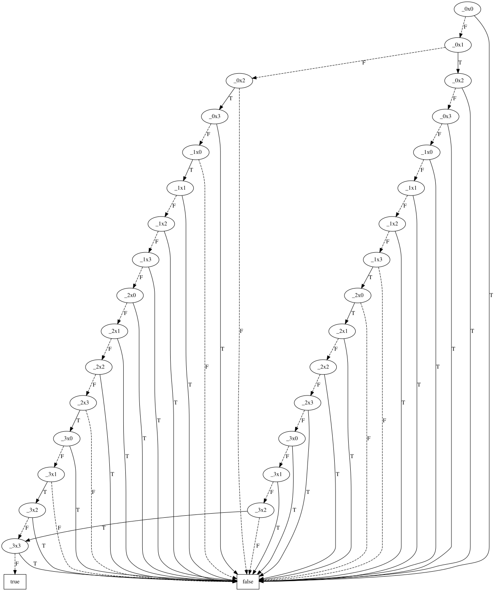
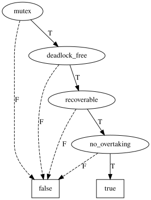
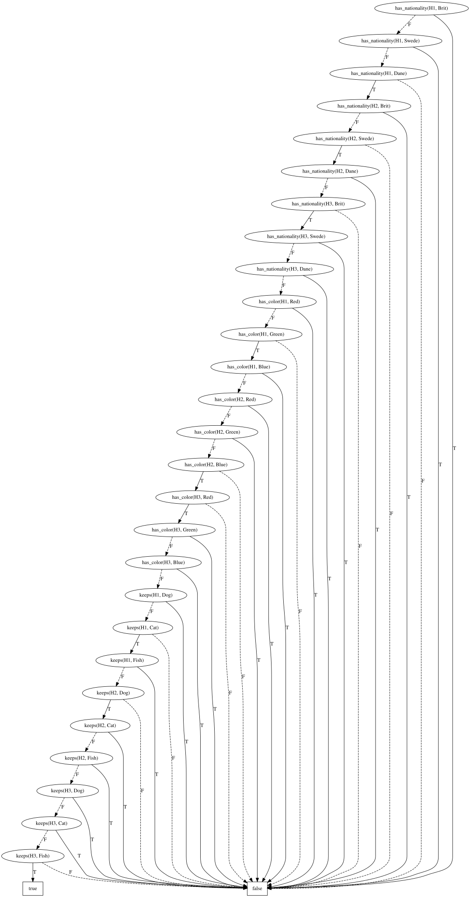
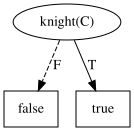
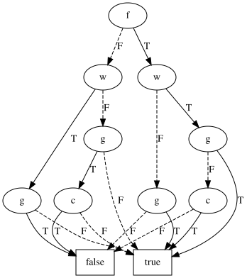
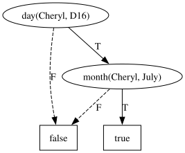

# Examples

## Example 1: transitivity of the `>=` operator

```
([a1,a2,a3,a4] >= [b1,b2,b3,b4] & [b1,b2,b3,b4] >= [c1,c2,c3,c4]) => [a1,a2,a3,a4] >= [c1,c2,c3,c4]
```

## Example 2: the 4 queens problem

The famous n-queens problem can be expressed efficiently in the RsBDD language.
The example below shows a 4-queens variant, which can be solved in roughly 15 milliseconds. The library contains a
generator for arbitrary n-queens problems.
At this point, the largest verified problem size is n=10, which reports all solutions in less 1 minute on modern hardware.
Further optimizations (such as multi-processor parallellism, or vertex ordering) could decrease the run-time in the future.

```
"every row must contain exactly one queen"
[_0x0, _0x1, _0x2, _0x3] = 1 &
[_1x0, _1x1, _1x2, _1x3] = 1 &
[_2x0, _2x1, _2x2, _2x3] = 1 &
[_3x0, _3x1, _3x2, _3x3] = 1 &

"every column must contain exactly one queen"
[_0x0, _1x0, _2x0, _3x0] = 1 &
[_0x1, _1x1, _2x1, _3x1] = 1 &
[_0x2, _1x2, _2x2, _3x2] = 1 &
[_0x3, _1x3, _2x3, _3x3] = 1 & 

"every diagonal must contain at most one queen"
[_0x0] <= 1 &
[_0x1, _1x0] <= 1 &
[_0x2, _1x1, _2x0] <= 1 &
[_0x3, _1x2, _2x1, _3x0] <= 1 &
[_1x3, _2x2, _3x1] <= 1 &
[_2x3, _3x2] <= 1 &
[_3x3] <= 1 &

"the other diagonal"
[_0x3] <= 1 &
[_0x2, _1x3] <= 1 &
[_0x1, _1x2, _2x3] <= 1 &
[_0x0, _1x1, _2x2, _3x3] <= 1 &
[_1x0, _2x1, _3x2] <= 1 &
[_2x0, _3x1] <= 1 &
[_3x0] <= 1
```

Running this example with the following arguments yields a truth-table showing the queen configuration(s) on a 4x4 chess
board.

```bash
rsbdd -i examples/4_queens.txt -t -ft
```

| _0x0  | _0x1  | _0x2  | _0x3  | _1x0  | _1x1  | _1x2  | _1x3  | _2x0  | _2x1  | _2x2  | _2x3  | _3x0  | _3x1  | _3x2  | _3x3  | *    |
|-------|-------|-------|-------|-------|-------|-------|-------|-------|-------|-------|-------|-------|-------|-------|-------|------|
| False | False | True  | False | True  | False | False | False | False | False | False | True  | False | True  | False | False | True |
| False | True  | False | False | False | False | False | True  | True  | False | False | False | False | False | True  | False | True |

The full BDD tests every square, most of them only to rule out a queen. `-c true` retains only the choices that can be
true: a variable whose `T` edge only leads to `false` is omitted (and reported on stderr as `omitted choice ...`), so
an omitted square has no queen. The BDD, obtained with `rsbdd examples/4_queens.txt -c true -d 4_queens.dot`, contains
both solutions as the two paths to `true`, and only tests the squares that hold a queen in one of them.



## Example 3: model checking Peterson's protocol

Peterson's algorithm lets two processes share a critical section using nothing but two flags and a `turn` variable.
A process that wants to enter raises its flag and politely gives the turn to the other process. It then waits until
the other process is not interested (its flag is down) or it is its own turn. On leaving, it lowers its flag.

[examples/peterson.txt](../examples/peterson.txt) encodes the protocol as a transition system `T` over the program
counters of both processes and the turn bit, and checks four properties using fixed points:

- `mutex`: no reachable state has both processes in the critical section (least fixpoint for reachability)
- `deadlock_free`: every reachable state has a successor
- `recoverable`: from every reachable state, P0 can still reach its critical section (least fixpoint)
- `no_overtaking`: while P0 waits, P1 cannot keep moving forever on its own (greatest fixpoint)

```
let Reach := lfp R # init |
    (exists a1, a0, b1, b0, t # R & T)[a1' := a1, a0' := a0, b1' := b1, b0' := b0, t' := t];

mutex <=> forall a1, a0, b1, b0, t # Reach => -(crit0 & crit1);
...
```

```bash
rsbdd examples/peterson.txt -t -ft
```

| mutex | deadlock_free | recoverable | no_overtaking | *    |
|-------|---------------|-------------|---------------|------|
| True  | True          | True        | True          | True |

In the BDD, obtained with `rsbdd examples/peterson.txt -d peterson.dot`, the only path to `true` sets every property
to true: the protocol satisfies all four.



### Finding bugs

Suppose P0 is "optimized" to enter the critical section without checking the flag and turn of P1:

```diff
-    wait0 & (idle1 | -t) & crit0[a1 := a1', a0 := a0'] & keept |
+    wait0 & crit0[a1 := a1', a0 := a0'] & keept |
```

Running the checks again shows that mutual exclusion is violated:

| mutex | deadlock_free | recoverable | no_overtaking | *    |
|-------|---------------|-------------|---------------|------|
| False | True          | True        | True          | True |

To find a counterexample, replace the four properties at the end of the file by a query for the bad states:

```
Reach & crit0 & crit1
```

| a1   | a0    | b1   | b0    | t    | *    |
|------|-------|------|-------|------|------|
| True | False | True | False | True | True |

Both processes are in the critical section (`10`) while the turn belongs to P1. This state is reached when P1 starts
waiting, P0 starts waiting and hands the turn to P1, P1 enters, and P0 barges in after it.

Other mistakes are found the same way. If neither process looks at `turn`, so a process only enters when the other is
idle, `deadlock_free` and `recoverable` fail: both processes can wait for each other forever. If P1 keeps the turn to
itself instead of handing it to P0, both `mutex` and `no_overtaking` fail.

## Example 4: a simplified Einstein riddle

[examples/einstein.txt](../examples/einstein.txt) solves Einstein's riddle using rewrite rules: five houses, and five
kinds of values (nationality, color, beverage, cigar and pet). Its BDD is too large to read, so
[examples/einstein_small.txt](../examples/einstein_small.txt) asks the same question, "who owns the fish?", for three
houses with a nationality, a color and a pet:

1) the Brit lives in the red house
2) the Swede keeps the dog
3) the green house is on the left of the blue house
4) the Dane lives in the first house
5) the fish does not live in the green house

```
house(H1) -> true;
...
left(H1, H2) -> true;
left(H2, H3) -> true;
...
forall h # house(h) => [keeps(h, Dog), keeps(h, Cat), keeps(h, Fish)] = 1;
forall p # pet(p) => [keeps(H1, p), keeps(H2, p), keeps(H3, p)] = 1;
...
forall h # house(h) => (has_color(h, Blue) => exists g # left(g, h) & has_color(g, Green));
has_nationality(H1, Dane);
forall h # house(h) => (has_color(h, Green) => -keeps(h, Fish))
```

The BDD, obtained with `rsbdd examples/einstein_small.txt -c true -d einstein_small.dot`, has a single path to `true`,
so the solution is unique. Following its `T` edges: the Dane lives in the green first house with the cat, the Swede in the
blue middle house with the dog, and the Brit in the red last house with the fish.



## Example 5: knights and knaves

On Raymond Smullyan's island, knights always tell the truth and knaves always lie. A visitor asks A whether he is a
knight or a knave, but cannot hear the answer. B says "A said that he is a knave", and C says "Don't believe B, he is
lying!".

[examples/knights_knaves.txt](../examples/knights_knaves.txt) gives every person a rule for their statement. A person
is a knight exactly when their statement is true. A's unheard answer is the unknown `claims_knave(A)`:

```
person(A) -> true;
person(B) -> true;
person(C) -> true;

statement(A) -> if claims_knave(A) then -knight(A) else knight(A);
statement(B) -> claims_knave(A);
statement(C) -> -knight(B);

forall p # person(p) => (knight(p) <=> statement(p))
```

```bash
rsbdd examples/knights_knaves.txt -t -ft
```

| knight(A) | claims_knave(A) | knight(B) | knight(C) | *    |
|-----------|-----------------|-----------|-----------|------|
| Any       | False           | False     | True      | True |

Nobody can say "I am a knave": a knight would be lying, and a knave would be telling the truth. So B is a knave and C
is a knight. A must have answered "I am a knight", which both knights and knaves can say, so A's type stays `Any`.

The BDD, obtained with `rsbdd examples/knights_knaves.txt -c true -d knights_knaves.dot`, omits the choices
`knight(B)` and `claims_knave(A)`, which must be false. Only `knight(C)` remains; `knight(A)` is not tested at all:



## Example 6: wolf, goat and cabbage

A farmer wants to cross a river with a wolf, a goat and a cabbage. The boat only has room for the farmer and one of
the three. Left alone, the wolf eats the goat, and the goat eats the cabbage.

[examples/wolf_goat_cabbage.txt](../examples/wolf_goat_cabbage.txt) gives every actor one bit for its bank (`false` is
the left bank). Like [examples/reachability.txt](../examples/reachability.txt), it computes the reachable states with a
least fixpoint over the current state `pf, pw, pg, pc` and the next state `f, w, g, c`:

```
let init := -f & -w & -g & -c;
let safe := -((w <=> g) & (f ^ g)) & -((g <=> c) & (f ^ g));

let T :=
    (f ^ pf) &
    ((w ^ pw) => (pw <=> pf)) &
    ((g ^ pg) => (pg <=> pf)) &
    ((c ^ pc) => (pc <=> pf)) &
    [w ^ pw, g ^ pg, c ^ pc] <= 1 &
    safe;

lfp R # init | exists pf, pw, pg, pc # R[f := pf, w := pw, g := pg, c := pc] & T
```

```bash
rsbdd examples/wolf_goat_cabbage.txt -t -ft
```

| f     | w     | g     | c     | *    |
|-------|-------|-------|-------|------|
| False | False | False | Any   | True |
| False | False | True  | False | True |
| False | True  | False | Any   | True |
| True  | False | True  | Any   | True |
| True  | True  | False | True  | True |
| True  | True  | True  | Any   | True |

The table covers 10 of the 16 states, including `f & w & g & c`: everything ends up on the right bank, so the puzzle is
solvable. The fixpoint does not record which crossings lead there. One of the two 7-move solutions takes the goat over,
returns, takes the wolf over, brings the goat back, takes the cabbage over, returns and takes the goat over.

The BDD, obtained with `rsbdd examples/wolf_goat_cabbage.txt -d wolf_goat_cabbage.dot`:



## Example 7: Cheryl's birthday

Cheryl gives Albert and Bernard a list of 10 possible dates for her birthday: May 15, 16, 19, June 17, 18, July 14, 16
and August 14, 15, 17. She tells Albert only the month and Bernard only the day.

1) Albert: I don't know when Cheryl's birthday is, but I know that Bernard does not know too.
2) Bernard: At first I didn't know when Cheryl's birthday is, but I know now.
3) Albert: Then I also know when Cheryl's birthday is.

[examples/cheryl.txt](../examples/cheryl.txt) turns every statement into a rewrite rule that narrows down the set of
candidate dates. The right-hand sides use quantifiers and term equality (`m2 = m`):

```
date(May, D15) -> true;
...
date(August, D17) -> true;

sum m # bernard_unsure(m) -> forall d # date(m, d) => exists m2 # -(m2 = m) & date(m2, d);
sum m, d # s1(m, d) -> date(m, d) & bernard_unsure(m);
sum m, d # s2(m, d) -> s1(m, d) & forall m2 # s1(m2, d) => m2 = m;
sum m, d # s3(m, d) -> s2(m, d) & forall d2 # s2(m, d2) => d2 = d;

forall m, d # date(m, d) => (birthday(m, d) <=> s3(m, d))
```

- `s1`: May and June contain a day that occurs only once (the 19th and the 18th), so Albert's month is July or August.
- `s2`: the 14th occurs in both remaining months, so Bernard's day is not the 14th.
- `s3`: August still has two dates left, so Albert's month is July.

```bash
rsbdd examples/cheryl.txt -t -ft
```

The truth table has a single row, in which only `birthday(July, D16)` is true: Cheryl's birthday is July 16.

The BDD, obtained with `rsbdd examples/cheryl.txt -c true -d cheryl.dot`, omits the nine dates that cannot be the
birthday, leaving a single choice:


