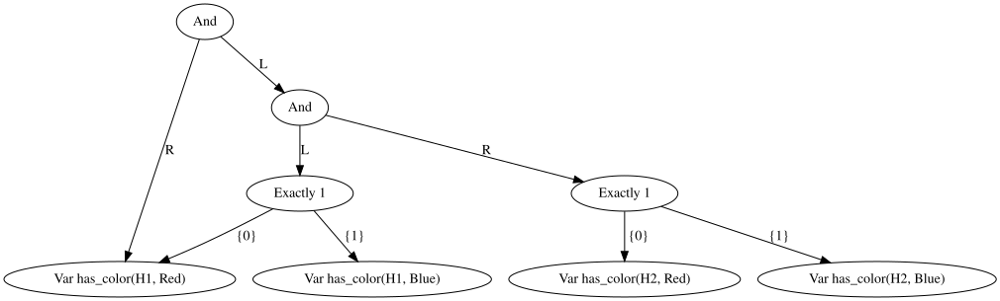

# Rewrite rules (experimental)

## Usage

Problems can be described as propositions over terms such as `Alice`, `suc(_0)` or `next(H1, H2)`, together with
rewrite rules defining some of these propositions.

```
"facts and rules"
house(H1) -> true;
house(H2) -> true;
left(H1, H2) -> true;
sum x, y # next(x, y) -> left(x, y) | left(y, x);

"constraints"
forall h # house(h) => [has_color(h, Red), has_color(h, Blue)] = 1;
has_color(H1, Red)
```

- `p(t1, .., tn) -> formula` is a rewrite rule. Like `=>` it binds weaker than `&` and `|`, so a rule in a `&`-chain
  needs parentheses: `(p(A) -> true) & ...`. Rules can also be separated using `;`.
- `sum x, y # rule` introduces pattern variables `x` and `y` which match any term. Every pattern variable must occur
  in the left-hand side of the rule.
- `t1 = t2` holds if both terms are identical.
- A proposition `p(..)` for which rules exist is rewritten to the conjunction of the right-hand sides of all matching
  rules. If no rule matches, or the rewriting is cyclic, the proposition is false.
- A proposition without any rules is an unknown: every distinct proposition, such as `has_color(H1, Red)`, becomes a
  boolean variable for the solver.
- `forall` and `exists` over a variable used as a term range over all ground terms occurring in the formula.
- `forall` and `exists` over an atom, such as `exists color(H1, _) # ...`, quantify the boolean variables of the
  unknowns in their body that match the atom, where `_` matches any term. This quantifies over the interpretation of
  a function: `exists color(H1, _)` asks for some color of house `H1`. The atom may contain pattern variables of the
  enclosing rule, as in `sum w # f(w) -> forall color(other(w), _) # ...`.
- Substitution also replaces atoms: `f[color(H1, _) := color(H2, _)]` replaces `color(H1, c)` by `color(H2, c)` for
  every term `c`.
- Rewrite rules must be top-level conjuncts of the formula.

The parse tree (`-p`) shows the formula after rewriting. For the example above, the rules are gone, the `forall` is
expanded over the houses `H1` and `H2`, and every remaining proposition is a boolean variable for the solver:



See [examples/peano.txt](../examples/peano.txt), [examples/peano_puzzle.txt](../examples/peano_puzzle.txt) and [examples/einstein.txt](../examples/einstein.txt).

The puzzle in [examples/peano_puzzle.txt](../examples/peano_puzzle.txt) asks for natural numbers `a`, `b` and `c` such
that `a + b = c`, `b + c = 5` and `a < b`. The BDD below, obtained with `rsbdd examples/peano_puzzle.txt -c true -d
peano_puzzle.dot`, has a single path to `true`: the unique solution `a = 1`, `b = 2` and `c = 3`. The `-c true` flag
omits every choice whose `T` edge only leads to `false`, such as `val(A, _0)`, so only the chosen values remain.


To inspect the ground formula produced by the rewrite rules, use `-w <file>` (or `-w -` for stdout). The output is a
plain rsbdd formula and can be solved again, e.g. `rsbdd examples/peano_puzzle.txt -w - | rsbdd -`.

## Combining rewrite rules and fixed points

Rewrite rules and fixed points can be used in the same formula. The example in
[examples/rooms.txt](../examples/rooms.txt) asks which rooms of a house can be reached from the hall. Rooms and doors are
facts, and `step(x, y)` is a rule over them. The location of the visitor is a function: `at(w, r)` states that in
state `w` the visitor is in room `r`. The least fixpoint then computes the set of reachable locations, without knowing
the number of steps in advance. The substitution renames the current location `Cur` to the previous location `Prev`.

```
let T := exists x, y # step(x, y) & is_at(Prev, x) & is_at(Cur, y);
let Reach := lfp R # is_at(Cur, Hall) | exists at(Prev, _) # R[at(Cur, _) := at(Prev, _)] & T;

door(Hall, Kitchen) -> true;
trapdoor(Attic, Hall) -> true;
...
sum x, y # step(x, y) -> door(x, y) | door(y, x) | trapdoor(x, y);
sum w, r # is_at(w, r) -> forall q # room(q) => (at(w, q) <=> q = r);

forall r # room(r) => (reachable(r) <=> exists at(Cur, _) # is_at(Cur, r) & Reach)
```

The trapdoor only leads from the attic to the hall, so the attic and the cellar cannot be reached.


The BDD obtained with `rsbdd examples/rooms.txt -c true -d rooms.dot` has a single path to `true`. The unreachable
attic and cellar are omitted:


```bash
rsbdd examples/rooms.txt -t -ft
```

| reachable(Hall) | reachable(Kitchen) | reachable(Garden) | reachable(Shed) | reachable(Attic) | reachable(Cellar) | *    |
|-----------------|--------------------|-------------------|-----------------|------------------|-------------------|------|
| True            | True               | True              | True            | False            | False             | True |


## Theorem proving

Rules whose right-hand side is a term, and proofs by induction, are described in
[Theorem proving](theorem_proving.md).
