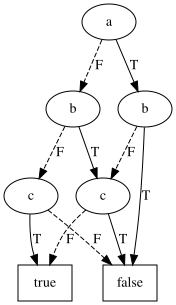
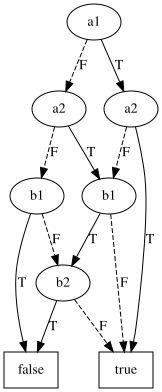
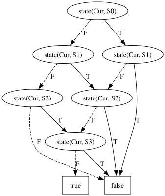

# Syntax

## Comments

Characters contained within "..." (excluding the " char itself) are regarded as comments and can be placed at any point
in the formula.

## Constants

The most basic building blocks of the syntax are 'variables' and 'constants'. A constant can be either 'true' or '
false'. A variable can accept either a 'true' or 'false' value after evaluation depending on its environment.

```
true
false
```

## Variables

A variable is a single word starting with a non-digit character. Examples of good variable names are:

```
a
a'
alpha
_x
a1
hello_world
```

## Negation

A variable, constant, or sub-formula can be negated using the negation operator. This operator can be expressed by
either `!`, `-`, or `not`.

```
not true
-false
!variable
```

## Binary operators

RsBDD supports the most common, and some uncommon binary operators, such as conjunction, disjunction, implication and
bi-implication.

Most operators have a symbolic and textual representation, e.g. `and` or `&`.

| Operator           | Option 1          | Option 2 |
|--------------------|-------------------|----------|
| Conjunction        | `and`             | `&`      |
| Disjunction        | `or`              | `\|`     |
| Implication        | `implies` or `in` | `=>`     |
| Bi-implication     | `iff` or `eq`     | `<=>`    |
| Exlusive or        | `xor`             | `^`      |
| Joint denial       | `nor`             | N.A.     |
| Alternative denial | `nand`            | N.A.     |

```
true or false
true | false
a | b
a & b
a and b
a => b
hello <=> world
on ^ off
```

## Operator precedence

Binary operators follow the usual precedence, from strongest to weakest binding:

| Precedence | Operators                 | Associativity |
|------------|---------------------------|---------------|
| 1          | `!` (negation)            | -             |
| 2          | `&`, `nand`               | left          |
| 3          | `^`                       | left          |
| 4          | `\|`, `nor`               | left          |
| 5          | `=>`, `<=`                | `=>`: right   |
| 6          | `<=>`                     | left          |

The body of a quantifier, fixed point or if-then-else extends as far to the right as possible.

```
a & b | c           <=> (a & b) | c
a & b => c          <=> (a & b) => c
a => b => c         <=> a => (b => c)
a & exists b # b | c <=> a & (exists b # (b | c))
```

## Composition

Larger formulae can be composed using left and right parentheses: `(`, `)`:

```
a | (a & b)
(a)
((a))
!(a & b)
(a & b) | (b & c)
```

## If-then-else

A simplification of a common expression `(a => b) & ((!a) => c)` can be made using the ternary if-then-else (ite)
operator.

```
if a then b else c
if exists a # a <=> b then b <=> c else false | c
```

## Quantifiers

The RsBDD supports universal and existential quantification using the `exists` and `forall`/`all`
keywords: `{forall|exists} var_1, var_2, .., var_n # {subformula}`

```
forall a # true
forall a # a | b
forall a, b # exists c # (c | a) & (c | b)
```

Quantifiers over terms, such as `forall p # person(p) => ...`, are described in
[Rewrite rules](rewriting.md).

## Counting

For some problems it can be beneficial to express properties relating to the number of true or false variables, e.g. "at
least 2 of the 4 properties must hold".

The counting operator (`[]`) in combination with five new equality and inequality operators (`=`, `<=`, `>=`, `<`, `>`)
can be used to concisely express these properties.

_Note:_ like most operators, the counting operator can be expressed using logic primitives, but this operator simplifies
the expression significantly.

A counting comparison can either be made by comparing a set of expressions to a given constant, or an other set of
expressions.

```
"exactly one of a, b, and c holds"
[a, b, c] = 1

"there are strictly less true expressions in a, b, c than d, e, f"
[a, b, c] < [d, e, f]
```

The BDD of `[a, b, c] = 1`, obtained with `rsbdd -e "[a, b, c] = 1" -d counting.dot`, has exactly one `T` edge on
every path to `true`:



Comparing two sets yields a BDD that weighs the variables of both sides. The BDD of `[a1, a2] >= [b1, b2]` leads to
`false` only if more of `b1, b2` hold than of `a1, a2`:



Counting comparison also allows us to specify optimization problems.
Example: the max-clique problem can be described as a clique problem, such that
for all satisfiable cliques, the reported result is the largest.

```
-(a & f) &
-(a & g) &

-(b & d) &
-(b & e) &

-(c & e) &
-(c & g) &

forall _a,_b,_c,_d,_e,_f,_g # (
    -(_a & _f) &
    -(_a & _g) &
    -(_b & _d) &
    -(_b & _e) &
    -(_c & _e) &
    -(_c & _g)
) => [a,b,c,d,e,f,g] >= [_a,_b,_c,_d,_e,_f,_g]
```

## Fixed points

The rsbdd language supports least-fixpoint (`lfp` / `mu`) and greatest-fixpoint (`gfp` / `nu`) operations to find a
respectively minimal or maximal solution by repeatedly applying a given transformer function until the solution is
stable.

Only monotonic transformer functions are guaranteed to terminate. Termination of fixed point operations are not checked
and will run indefinatedly if not handled correctly.

Its basic properties are defined as follows.

```
gfp X # X           <=> true
lfp X # X           <=> false

nu X # ...          <=> gfp X # ...
mu X # ...          <=> lfp X # ...

gfp/lfp X # a       <=> a
gfp/lfp X # true    <=> true
gfp/lfp X # false   <=> false
```

## Definitions and constraint lists

A formula can be split into a list of constraints separated by `;`. The list holds when every constraint holds. A trailing
`;` is allowed.

```
[a, b, c] = 1;
a => -b;
```

Sub-formulae can be named using `let name := formula;` at the start of a file. A definition is used by its name (or
`{name}`) in all following definitions and constraints, and is replaced by its formula when evaluated. A definition may
refer to the variable of an enclosing fixed point.

```
let init := -x & -y;
let step := X | (x & -y);
lfp X # init | step
```

## Substitution

The postfix `formula[x := y, ...]` replaces variables in a formula by other variables or constants. This is
particularly useful in fixed points, for example to compute the predecessor of a set of states. A replaced variable may
not be used as a replacement in the same substitution, so `[x := y, y := x]` is rejected.

```
(a & b)[a := c]     <=> c & b
(a & b)[a := true]  <=> b
```

The example below computes all states reachable from state `00` in a transition system `T` over current-state
variables `p1, p0` and next-state variables `x1, x0` (see [examples/reachability.txt](../examples/reachability.txt)).

```
let init := -x1 & -x0;
let T := ...;
lfp R # init | exists p1, p0 # R[x1 := p1, x0 := p0] & T
```

The resulting BDD, obtained with `rsbdd examples/reachability.txt -d reachability.dot`, is the set of reachable states:
every state except `11` (`x1 & x0`) is reachable.



## Parse-tree display

Adding the `-p {path}` argument to `rsbdd` constructs a graphviz graph of the parse-tree. This can be used to for
introspection of the intended formula, or for reporting purposes. An example of the parse-tree output
for `exists b,c # a | (b ^ c)` is displayed below.


