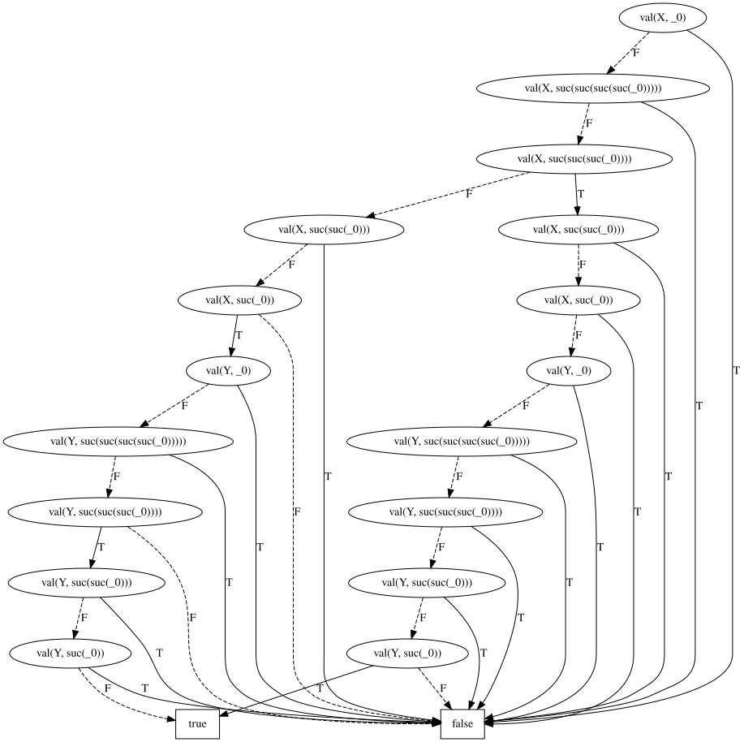

# Theorem proving

This chapter builds on [Rewrite rules](rewriting.md).

## Theorem proving by term rewriting

A symbol used inside a term or as an operand of `=` is a function symbol. Its rules are term rules: the right-hand
side is a term instead of a formula.

```
sum y # plus(_0, y) -> y;
sum x, y # plus(suc(x), y) -> suc(plus(x, y));

plus(suc(_0), suc(_0)) = suc(suc(_0))
```

- Terms are rewritten to normal form (innermost first, using the first matching rule) before they are compared,
  matched against rules or turned into boolean variables. `t1 = t2` therefore holds modulo the term rules, and
  `p(plus(_0, A))` and `p(A)` are the same proposition.
- If the term rules form a convergent (terminating and confluent) rewrite system, two terms are equal in the
  equational theory of the rules if and only if their normal forms are identical (Knuth & Bendix, 1970; Baader &
  Nipkow, *Term Rewriting and All That*, 1998). A theorem is proven if the formula evaluates to `true`.
- The rules are [completed](#completion) if possible. Otherwise convergence is not checked: a non-terminating system
  does not terminate, and the result of a non-confluent system depends on the order of the rules.
- Quantifiers range over the normal forms of the ground terms in the formula and an arbitrary constant. The theorem
  `forall x # plus(x, _0) = x` is therefore not proven by rewriting, as `plus(x', _0)` cannot be rewritten. Use
  `induct` for a proof for all values.

See [examples/peano_arith.txt](../examples/peano_arith.txt) and [examples/group.txt](../examples/group.txt), which proves
theorems of group theory from the group axioms by [completion](#completion).

Term rules combine with unknowns solved by the solver. [examples/peano_solve.txt](../examples/peano_solve.txt) finds
natural numbers `x` and `y` with `x + y = 4` and `x * y = 3`, and proves by refutation that `x` is odd in every
solution: adding the negation of the theorem makes the formula unsatisfiable.

```bash
rsbdd examples/peano_solve.txt -t -ft
```

The BDD, obtained with `rsbdd examples/peano_solve.txt -c true -d peano_solve.dot`, has two paths to `true`:
`x = 1, y = 3` and `x = 3, y = 1`. The `-c true` flag omits every value that occurs in no solution.



## Completion

Term rules need not form a convergent rewrite system: they are completed by Knuth-Bendix completion (Knuth & Bendix,
1970), which adds the equations needed for confluence (critical pairs) as new rules. The three group axioms below do
not rewrite `mul(x, e)`, but completion derives the convergent rewrite system of Knuth and Bendix, with rules such as
`mul(x, e) -> x` and `inv(inv(x)) -> x`, which prove both goals.

```
sum x # mul(e, x) -> x;
sum x # mul(inv(x), x) -> e;
sum x, y, z # mul(mul(x, y), z) -> mul(x, mul(y, z));

mul(x, e) = x;
mul(x, inv(x)) = e
```

- The given rules keep their direction. Derived equations are oriented by the lexicographic path order, with the
  default precedence of Prover9: constants are the smallest symbols, followed by symbols of increasing arity, with
  unary symbols the largest. Symbols of the same arity are ordered by their first occurrence.
- A name in a goal that does not occur in the rules, such as `x` above, is an arbitrary constant: the goal is proven
  for every value of `x`, like the Skolem constant Prover9 introduces when denying the goal.
- A completed rule set has equational semantics: with `f(a) -> b; f(a) -> c`, both `f(a) = b` and `f(a) = c` hold.
- If completion fails, because a derived equation cannot be oriented or completion does not finish within 1000 steps,
  the rules are used as given. A given rule that does not terminate, such as `f(x, y) -> f(y, x)`, still does not
  terminate.

See [examples/right_identity.txt](../examples/right_identity.txt), the same problem as
[examples/in_progress/right-identity.prover9.txt](../examples/in_progress/right-identity.prover9.txt) for Prover9.

## Proofs by induction

Rewriting proves `plus(suc(_0), _0) = suc(_0)`, but not `plus(x, _0) = x` for every natural number `x`: `plus`
recurses on its first argument, so `plus(x, _0)` cannot be rewritten while `x` is unknown. `induct` proves such an
equation by structural induction.

```
sum y # plus(_0, y) -> y;
sum x, y # plus(suc(x), y) -> suc(plus(x, y));

induct x # plus(x, _0) = x;
induct x, y # plus(x, suc(y)) = suc(plus(x, y));
induct x, y # plus(x, y) = plus(y, x)
```

- `induct x, y # l = r` proves the equation `l = r` by induction on `x`, for every value of `y`.
- The cases are the patterns of the rules of the function applied to `x` (a cover set): `_0` and `suc(x')` for
  `plus`. A case is proven if both sides rewrite to the same normal form. The induction hypothesis for every variable
  of the pattern, such as `plus(x', _0) = x'`, is used as an extra rewrite rule in that case.
- If the sides of a case have different normal forms, the case is generalised into a lemma: the variables and
  Skolem constants such as `x'` become variables. The lemma is proven by induction on one of its variables, using
  the definitions and proven lemmas but not the induction hypotheses, and becomes a rewrite rule. Lemmas are
  speculated up to two levels deep. Commutativity of `plus` is proven without stating any lemma: its cases need
  `plus(y, _0) = y` and `plus(y, suc(x)) = suc(plus(y, x))`, which are discovered.
- A proven equation `l = r` becomes the rewrite rule `l -> r` (or `r -> l` if `l` is a variable) for the remainder of
  the formula, so it can be used as a lemma. An equation such as commutativity, which would rewrite forever, is not
  added. In the example above, the first two theorems are also discovered as lemmas if they are not stated.
- `induct` is `true` if the equation is proven, and `false` if it is not. As the method is incomplete, `false` means
  "not proven" rather than "disproven", so `induct` should not be negated.

This follows the Boyer–Moore approach (Boyer & Moore, *A Computational Logic*, 1979): the induction scheme follows the
recursion of the definitions (cover set induction; Zhang, Kapur & Krishnamoorthy, 1988), the hypothesis is used by
rewriting (rewriting induction; Reddy, 1990), and proven theorems become rewrite rules.

Limitations:
- Only lemmas that generalise a stuck case are discovered. A lemma that cannot be oriented, such as a permutative
  lemma `plus(x, plus(y, z)) = plus(y, plus(x, z))`, cannot be used as a rewrite rule, so commutativity of `times`
  is not proven.
- The body of `induct` must be a single equation.
- The patterns of the rules are assumed to cover all values (sufficient completeness): the theorem is proven for the
  terms covered by the rules, i.e. `_0` and `suc(..)`.
- Induction variables must not be used as constants in the rules.

See [examples/induction.txt](../examples/induction.txt), which proves identity, commutativity and associativity of
addition.

## First-order proofs

The solver decides formulas over the ground terms in the formula (and an arbitrary constant for every quantified
variable), which is a finite model check. `rsbdd --prove` instead decides whether a formula is a theorem of
first-order logic with equality, over every domain. For example, `exists x, y # -(x = y)` holds over the terms in the
formula, but it is not a theorem, as a domain may have a single element.

```bash
rsbdd examples/fol/dreadbury.txt --prove
```

[examples/fol/dreadbury.txt](../examples/fol/dreadbury.txt) is Pelletier's problem 55 (TPTP PUZ001), *who killed Aunt
Agatha?*: the facts imply that Agatha killed herself. The output is the proof, ending in `theorem`:

```
0. lives(sk1) [negated goal]
1. killed(sk1, agatha) [negated goal]
...
136. (sk1 = agatha) [simplification 122, 63]
140. -killed(sk1, agatha) [superposition 136, 14]
161. false [simplification 140, 1]
theorem
```

- The rewrite rules are axioms, read as in finite mode: a term rule `l -> r` is the equation `l = r` for all values
  of its variables, and the rules of a predicate are its definition (Clark completion): an application holds if and
  only if some rule matches, and the right-hand side of every matching rule holds. The rest of the formula is the
  goal.
- Distinct names are distinct elements (unique names), unless an equation of the formula relates them. See
  [Finite mode and first-order proofs](finite_and_first_order.md#unique-names).
- Names that are not bound by a quantifier are constants, so a goal holds for every value of them. Boolean variables
  are propositions, and a quantifier over a boolean variable ranges over `true` and `false`.
- The negated goal and the axioms are Skolemized and converted to clauses (with definitions for large subformulas;
  Plaisted & Greenbaum, 1986). The clauses are saturated by superposition (Bachmair & Ganzinger, 1994) in a
  given-clause loop: superposition, equality resolution and equality factoring, restricted by the lexicographic path
  order of [completion](#completion) and a selected negative literal. Clauses are simplified by demodulation with
  oriented unit equations, and deleted if they are tautologies or subsumed. A predicate `p(..)` is the equation
  `p(..) = true`.
- Every line of the proof is a clause with the rule that derived it and the clauses it was derived from;
  simplification also lists the unit equations it rewrote with.
- The result is `theorem` with the proof (exit status 10) if the empty clause is derived, `not a theorem` (20) if the
  clauses are saturated without it, and `unknown` (30) if no proof is found within 100000 given clauses. As
  first-order validity is undecidable, a formula that is not a theorem may also give `unknown`.
- Counting, fixed points, atom quantifiers and atom substitution are evaluated as in finite mode, and an equation
  proven by `induct` becomes an axiom. The differences between `--prove` and finite mode are described in
  [Finite mode and first-order proofs](finite_and_first_order.md).

More puzzles in [examples/fol](../examples/fol): the barber paradox ([barber.txt](../examples/fol/barber.txt)), the
drinker paradox ([drinker.txt](../examples/fol/drinker.txt)), Lewis Carroll's animals puzzle
([animals.txt](../examples/fol/animals.txt)), Schubert's Steamroller
([steamroller.txt](../examples/fol/steamroller.txt)), and groups in which every element is its own inverse
([boolean_group.txt](../examples/fol/boolean_group.txt)).

The prover proves the first-order problems of Pelletier's *Seventy-five problems for testing automatic theorem
provers* (1986) in [tests/prover.rs](../tests/prover.rs), including Andrews' challenge (problem 34) and the problems
with equality, and the group theory of [examples/group.txt](../examples/group.txt) and
[examples/right_identity.txt](../examples/right_identity.txt).

Limitations, compared with provers such as Prover9, E or Vampire: there is no indexing (every inference and
simplification scans all clauses), no backward demodulation, no AC-unification, and the term order and clause
selection are fixed. Larger problems, such as most of the TPTP library, are out of reach.
